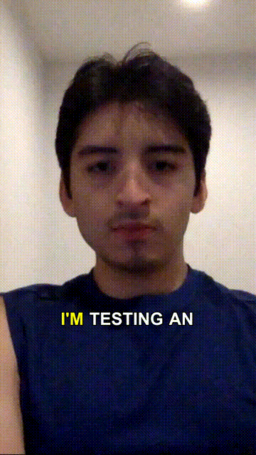

# AI Video Editor

An AI-powered short-form video editing pipeline built with Python, Whisper, and FFmpeg.

The project takes raw talking-head footage and automatically transforms it into vertical short-form content by removing silence, generating timed captions, and applying face-tracked 9:16 cropping.

## Demo


## How It Works

1. FFmpeg detects and removes long silent sections.
2. Whisper transcribes speech with word-level timestamps.
3. OpenCV tracks the speaker and reframes the video to 9:16.
4. Styled captions are generated and burned into the video.
5. FFmpeg exports the finished short-form video.

## Architecture

```text
Raw Video
   ↓
Silence Removal
   ↓
Whisper Transcription
   ↓
Face Tracking
   ↓
9:16 Reframing
   ↓
Caption Rendering
   ↓
Final Short


## Features

- Automatic silence and dead-space removal
- Whisper transcription with word-level timestamps
- Styled burned-in captions
- Face-tracked vertical 9:16 cropping
- Center-crop vertical mode
- Retro VHS/CRT look (`--vhs`): scanlines, color fringing, grain, glow, vignette
- "Then vs today" scrolling comparison wall (see below)
- Glitch transitions between clips: whip blur, RGB split, torn slices, flash on the cut
- Slide/push transitions: the next clip shoves the last one off screen, with easing and motion blur
- Modular Python architecture
- Command-line interface for running individual editing steps or the full pipeline

## Tech Stack

- Python
- FFmpeg
- OpenAI Whisper
- OpenCV
- NumPy

## Run the Full Pipeline

Activate the virtual environment:

```bash
source .venv/bin/activate

python pipeline.py your_video.mp4 --short

## Then-vs-Today Comparison Wall

Rows of images and video clips, each with a caption ("Rome, 80 AD" / "Today"), scroll upward like a feed. The centre row stays sharp while rows above and below fade into blur and shadow.

Describe the rows in a JSON file (paths are relative to the file):

```json
{
  "rows": [
    [{"source": "rome.jpg", "label": "Rome, 80 AD"}, {"source": "today.mp4", "label": "Today"}],
    [{"source": "paris.jpg", "label": "Paris, 1847"}, {"source": "club.mp4", "label": "Today"}]
  ]
}
```

Render it, then optionally add the VHS look:

```bash
python -m avshort.wall wall.json -o wall.mp4 --duration 10 --speed 120
python pipeline.py wall.mp4 --vhs -o wall_vhs.mp4
```

## Glitch Transitions

Join clips end to end with a glitch at every cut. Frames break apart as the cut approaches (whip blur, red/blue split, sideways-torn bands, corrupted blocks), flash on the cut, then recover. Clips of different sizes are cropped to match the first one, and each clip's audio stays in sync (silent clips get silence).

```bash
python -m avshort.transitions intro.mp4 broll.mp4 outro.mp4 -o joined.mp4 --length 0.4 --strength 1.0
```

### Slide/Push

The next clip slides in and shoves the current one off screen. The move eases in and out, with motion blur at top speed. Clips overlap during the push and their audio crossfades, so the result is shorter by one transition length per cut.

```bash
python -m avshort.transitions intro.mp4 broll.mp4 outro.mp4 --style push -o joined.mp4
python -m avshort.transitions a.mp4 b.mp4 --style push --direction up --length 0.6
```

